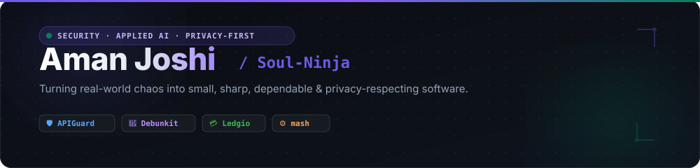

 

 

 

 

<h2>👋 About Me</h2>

<table>
<tr>
<td valign="top" style="vertical-align:top">
<h3>💫 The short version</h3>

I'm <b>Aman Joshi</b> — a B.Tech CSE (AI/ML) student at <b>Dronacharya College of Engineering</b>, New Delhi, who enjoys turning messy, real-world problems into small, sharp, dependable software.

My work sits where <b>applied AI</b>, <b>security engineering</b> and <b>privacy-first product design</b> meet. I like building tools that respect the person using them: offline-capable, transparent about what they do, and free of dark patterns.

<ul>
<li>🛡️ Building <b>APIGuard</b> — a graph-guided API authorization &amp; BOLA detection engine</li>
<li>🧠 Building <b>Debunkit</b> — AI-assisted fact-checking with live web evidence and transparent verdicts</li>
<li>💳 Building <b>Ledgio</b> — a private, offline-first personal finance ledger &amp; installable PWA</li>
<li>⚙️ Wrote <b>mash</b> — a POSIX-style shell built on raw kernel syscalls (<code>fork</code>, <code>execvp</code>, PCB management)</li>
<li>🌱 Learning in public, solving LeetCode, contributing to open source</li>
<li>💞 Always happy to collaborate on security tooling, AI apps &amp; privacy-first products</li>
</ul>
</td>
<td valign="top" style="vertical-align:top">
<h3>🧭 Currently</h3>
<ul>
<li><b>Studying</b> B.Tech CSE (AI/ML) at Dronacharya College of Engineering, New Delhi</li>
<li><b>Shipping</b> APIGuard — hardening the auth layer of modern APIs</li>
<li><b>Deepening</b> FastAPI, Flask &amp; React + TypeScript</li>
<li><b>Exploring</b> LLM pipelines, NLP and graph algorithms for security</li>
<li><b>Studying</b> process management, scheduling &amp; OS internals</li>
</ul>
<h3>🧩 Toolbox</h3>

Python · Flask · FastAPI · Java · JavaScript · TypeScript · React · HTML/CSS · PostgreSQL · Supabase · SQLite · Git · GitHub Actions

</td>
</tr>
</table>

 

<h2>🛠️ Tech Stack</h2>

 

<h2>🚀 Featured Projects</h2>

<table>
<tr>
<td align="center"></td>
<td align="center"></td>
<td align="center"></td>
</tr>
</table>

 

| Project | What it does | Try it |
| :-- | :-- | :-- |
| **Ledgio** | Private, offline-first personal finance ledger. Budgeting, loan tracker, biometric vault, cloud sync. | [Launch](https://ledgio.pages.dev/) · [Source](https://github.com/Soul-Ninja/Ledgio) |
| **Debunkit** | AI-assisted misinformation detection for headlines, URLs and articles — live web evidence, transparent verdicts, editorial dispatch. | [Launch](https://debunkit-production.up.railway.app) · [Source](https://github.com/Soul-Ninja/Debunkit) |
| **APIGuard** | Graph-guided API authorization & **BOLA** detection engine. FastAPI + React 19 + TypeScript, aligned to OWASP API Security #1. | [Launch](https://soul-ninja.github.io/APIGuard/) · [Source](https://github.com/Soul-Ninja/APIGuard) |

 

<h2>🗂️ More Projects</h2>

| Repository | Description | Stack |
| :-- | :-- | :-- |
| [mash-os-project](https://github.com/Soul-Ninja/mash-os-project) | `mash` — a custom POSIX-compliant shell demonstrating direct kernel interaction and raw process management. | Python · OS |
| [sepsis-early-warning-demo](https://github.com/Soul-Ninja/sepsis-early-warning-demo) | Research prototype for early sepsis warning from ICU time-series data. *(fork)* | Python |
| [freeCodeCamp](https://github.com/Soul-Ninja/freeCodeCamp) | freeCodeCamp.org's open-source codebase and curriculum. *(fork)* | TypeScript |
| [zulip](https://github.com/Soul-Ninja/zulip) | Zulip server and web application — open-source team chat. *(fork)* | Python |
| [validator.js](https://github.com/Soul-Ninja/validator.js) | String validation library. *(fork)* | JavaScript |
| [first-contributions](https://github.com/Soul-Ninja/first-contributions) | A beginner-friendly guide to making your first open-source contribution. *(fork)* | — |

 

<h2>📊 GitHub Stats</h2>

 

<table>
<tr>
<td align="center"></td>
<td align="center"></td>
</tr>
<tr>
<td align="center"></td>
<td align="center"></td>
</tr>
</table>

 

 

<h2>🐍 Contribution Snake</h2>

 

<h2>🌐 Connect With Me</h2>
 

 

