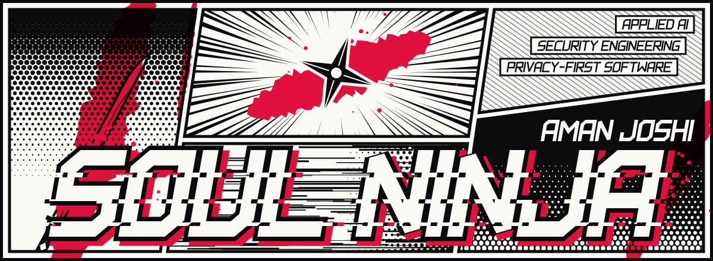
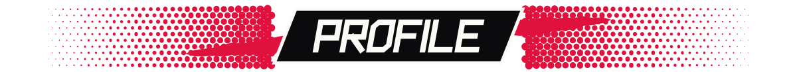
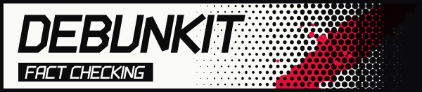
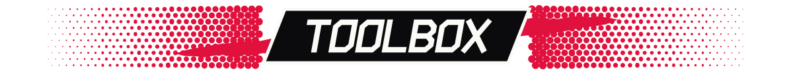

  

<h3>Aman Joshi</h3>

B.Tech CSE (AI/ML) student at <b>Dronacharya College of Engineering</b>, New Delhi. 
I turn messy, real-world problems into small, sharp, dependable software.

My work sits where <b>applied AI</b>, <b>security engineering</b> and <b>privacy-first product design</b> meet: 
tools that work offline, say what they do, and carry no dark patterns.

<b>Now shipping</b> APIGuard &nbsp;·&nbsp; <b>Now learning</b> LLM pipelines, NLP, graph algorithms, OS internals &nbsp;·&nbsp; <b>Open to</b> collaborations

 

<table>
<tr>
<td width="50%" align="center" valign="top">

Graph-guided API authorization and <b>BOLA</b> detection engine. FastAPI, React 19 and TypeScript, aligned to OWASP API Security #1.

</td>
<td width="50%" align="center" valign="top">

AI-assisted misinformation detection for headlines, URLs and articles. Live web evidence and transparent verdicts.

</td>
</tr>
<tr>
<td width="50%" align="center" valign="top">

Private, offline-first personal finance ledger and installable PWA. Budgeting, loan tracker, biometric vault, cloud sync.

</td>
<td width="50%" align="center" valign="top">

A POSIX-style shell built on raw kernel syscalls. <code>fork</code>, <code>execvp</code> and PCB management, in Python.

</td>
</tr>
</table>

 

 

 

 

 

 

